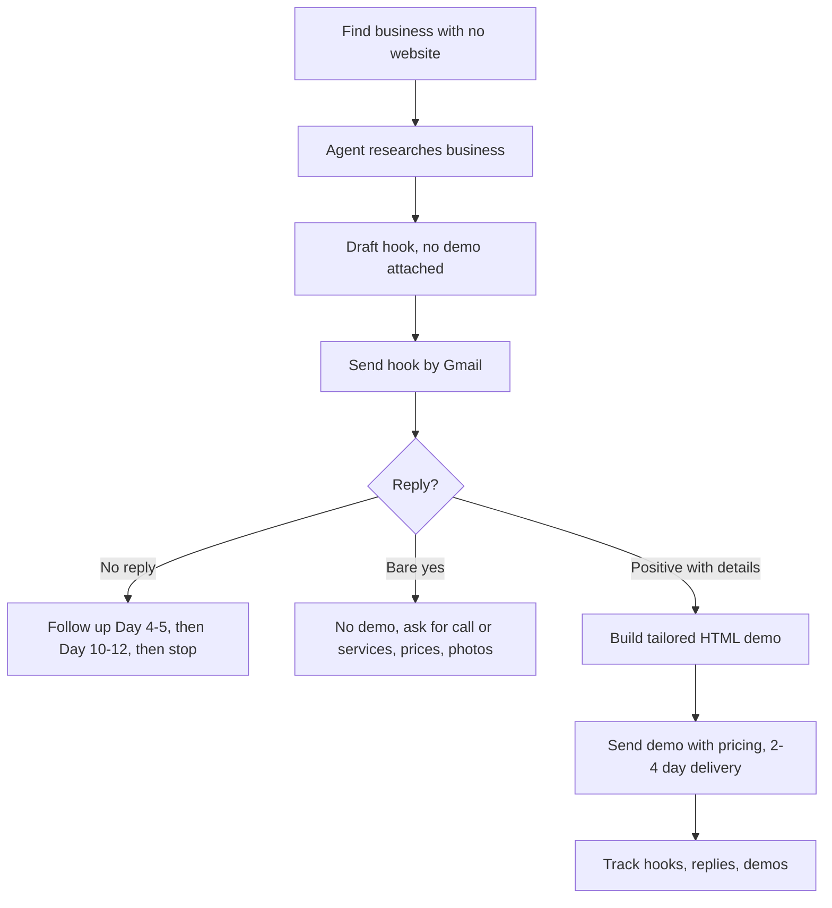

# Automated Email Outreach Agent

Autonomous AI outreach for a web design agency. It finds businesses with no website, sends a personalized hook, follows up on schedule, and builds a concept demo site only after a positive reply.

Live agency: northbeamstudios.online

## Result in 10 seconds

- Reached 637 businesses without websites, as measured by 637 personalized hooks sent and 2 positive replies, by building a two-stage autonomous agent system that researches prospects, drafts hooks, and schedules follow-ups.
- Converted replies into sales-ready demos, as measured by 5 concept demo sites built for salons, spas, and dental clinics, by generating tailored HTML demos only after a positive reply, with delivery in 2-4 days.
- Cut manual prospecting to a daily autonomous run, as measured by up to 100 hooks sent in one day with no manual drafting, by wiring scheduling, Gmail sending, reply tracking, and demo delivery into one pipeline.

## How it works in 30 seconds

1. Find a business with no website.
2. An agent researches it and drafts a short hook. No demo is attached.
3. Send the hook by Gmail.
4. If there is no reply, follow up at 4-5 and 10-12 business days, then stop.
5. If there is a positive reply with details, build a tailored HTML demo and send it with pricing.
6. A bare yes never triggers a demo. The prospect must book a call or reply with services, prices, and photos first.

## Workflow



Text version of the same flow, for a quick scan:

```
Find business (no website)
  -> Research business
  -> Draft hook (no demo)
  -> Send hook by Gmail
  -> Reply?
       No: Follow up Day 4-5, then Day 10-12, then stop
       Bare yes: No demo, ask for call or details
       Positive with details: Build HTML demo -> Send demo with pricing -> Track
```

## Key decisions

- Two stages, on purpose. Demos are expensive to build, hooks are cheap to send. No demo is built before first contact.
- A reply is not intent. A bare yes costs nothing, so it produced demos that went nowhere. The expensive step is gated on a concrete next action.
- Daily runs only work with a hard cap and a tracker. This system caps at 100 hooks a day and logs every hook, reply, and demo, otherwise duplicates and spam follow.

## Tech stack

Python, AI agents (Muse), Gmail API, HTML/CSS, Vercel for demo hosting, PayPal for payments.

## Repo structure

```
src/
  prospect.py       # prospect research, no-website check
  hook.py           # hook drafting from templates/hook.txt, prints draft, sends nothing by default
  send.py           # Gmail send, refuses without credentials, daily batch cap 100
  followup.py       # 4-5 and 10-12 business day follow-up dates, no sending
  demo.py           # demo generator, runs only after a positive reply with details
  tracker.py        # local JSON tracker, hooks sent, replies, demos built
templates/
  hook.txt          # hook template, placeholders only, no real prospect data
  demo/             # generic demo template, no real business branding
examples/
  sample-hook.txt   # one sanitized example hook, fake business only
docs/
  architecture.md   # pipeline diagram and the bare-yes rule
```

## Run the demo

```bash
pip install -r requirements.txt
cp .env.example .env   # add your own Gmail API credentials, never commit .env
python src/hook.py --business "Sample Salon" --city "Sample Town"
```

This prints a draft hook for a fake business. It sends nothing without Gmail credentials and an explicit `--send` flag.

```bash
python src/followup.py --date 2026-11-23
python src/demo.py --business "Sample Salon" --city "Sample Town" --booked-call
```

## What is deliberately not in this repo

- Real prospect lists, email addresses, or sent-mail history
- Real client demo sites with business names, photos, or addresses
- Gmail OAuth tokens, API keys, or `.env` files
- Pricing negotiation history
